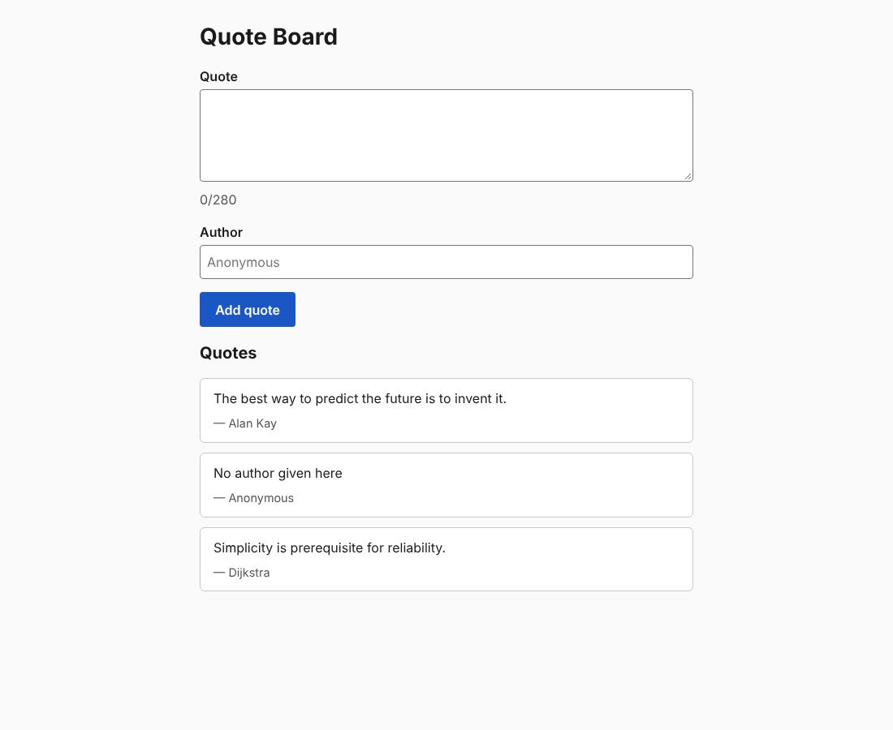

# Live Run: Quote Board (2026-11-16)

The first complete five phase Hive build with real agents at every level. The orchestrator ran headless from the plugin (`claude -p --plugin-dir plugins/hive "/hive:build plan.md"`). Every manager, supervisor, worker and bid was a real Claude process.

## Plan

A single page web app to share quotes: list newest first, a form with validation (text 3 to 280 characters, author optional, default "Anonymous"), server side persistence that survives restart, `GET` and `POST /api/quotes` with HTTP 400 on invalid input. Node.js 20+, minimal dependencies, web only.

## Outcome

| Measure | Result |
|---|---|
| Phases | 5 of 5 passed their gates |
| Tasks | 40 dispatched: 39 PASS, 1 FAIL (engine scope bug, fixed during the run) |
| Levels used | orchestrator, 9 manager runs, 14 supervisor runs, 17 worker runs |
| Distinct roles used | 22 of 91 (commanders chose only the reports a tiny product needs) |
| Spend | $6.51 agents + $0.66 orchestrator = **$7.17** (ceiling $30) |
| Bidding overhead | 40 bids, $0.05 total |
| Tests in the product | 74, all passing on a fresh clone |

Cost-limited policy for this run: managers sonnet only, supervisors and workers haiku or sonnet, max effort high.



## Independent verification (not the agents' word)

| Check | Result |
|---|---|
| Fresh `git clone`, `npm install`, `npm test` | 74 of 74 pass |
| `GET /api/quotes` on a fresh data file | `[]` |
| `POST` valid quote | 201 with id, text, author, createdAt |
| `POST` without author | stored as "Anonymous" |
| `POST` text "no" | HTTP 400 `{"error":"Validation failed","details":{"text":"Text must be at least 3 characters"}}` |
| Path traversal `/../package.json` | 404 |
| Restart the server | both quotes still there, newest first |
| Browser (Chromium): submit invalid, then valid | error shown, new quote appears first, no JavaScript errors |
| 360px mobile width | no horizontal overflow |

## Chain of command as executed

```
[PASS ] T0001-mgr-product  Phase 1: discovery  (sonnet/medium, $0.24)
    [PASS ] T0002-sup-requirements  (sonnet/low)
        [PASS ] T0003-wrk-user-stories  (sonnet/high, 2 attempts)
        [PASS ] T0004-wrk-plan-parser   (haiku/low, $0.02)
        [PASS ] T0005-wrk-scope-risk    (sonnet/high, 2 attempts)
[PASS ] T0006-mgr-architecture  Phase 2  (sonnet/medium)
    [PASS ] T0007-sup-system-design
        [PASS ] T0008-wrk-ownership-mapper  (haiku/medium)
    [PASS ] T0009-sup-scaffold  (haiku/low)
        [PASS ] T0010-wrk-tooling-config  (haiku/low)
        [PASS ] T0011-wrk-env-config      (haiku/low)
[FAIL ] T0012-mgr-backend  Phase 3a  (scope bug, see finding 4)
    [PASS ] T0013-sup-data      → T0014-wrk-repository-layer
    [PASS ] T0015-sup-api       → T0016-wrk-endpoint-builder
[PASS ] T0017-mgr-backend  Phase 3a r2  (resumed: told T0013 to T0016 already passed, ran review only)
[PASS ] T0020-mgr-frontend  Phase 3b → sup-pages → wrk-page-builder
[PASS ] T0023-mgr-product  Phase 1 r2: unique acceptance criteria IDs before quality
[PASS ] T0026-mgr-quality  Phase 4 → sup-testing → 4 workers (43 ACs traced, integration tests on the real server)
[PASS ] T0032-mgr-quality  Phase 4 r2 → a11y contrast fix, security headers
[PASS ] T0037-mgr-release  Phase 5 → sup-deploy-docs → README, release notes with clean checkout proof
```

## Model bidding in practice

| Model/effort | Attempts | Pass rate | Spend |
|---|---|---|---|
| haiku/low | 4 | 100% | $0.05 |
| haiku/medium | 3 | 33% | $0.04 |
| sonnet/low | 10 | 100% | $1.36 |
| sonnet/medium | 19 | 95% | $3.28 |
| sonnet/high | 6 | 100% | $1.72 |

Bidders chose haiku for mechanical single file work (requirements extraction, config files) and sonnet for code and coordination. Both haiku/medium failures were caused by malformed briefs (finding 2), not by the model. The retries escalated to sonnet/high as designed.

## Findings from this run and their fixes

Each was found by running the real system, fixed in the engine, and covered by a test.

| # | Finding | Fix |
|---|---|---|
| 1 | In the first attempt of this run, managers decided the product was "tiny" and wrote documents themselves with zero children. A manager even reported PASS while stating lint and test would fail. | Engine enforced delegation: commanders with no children fail, managers may not edit project files, supervisors are capped at glue sized edits. `@commands` verify makes the project's own build and test commands mandatory from phase 2. |
| 2 | A supervisor wrote paths with a trailing colon (`docs/product/scope-risks.md:`) in `verify` and `scope`. A worker attempt was wasted, then a stronger worker created a file literally named with the colon. | Briefs are linted before dispatch and rejected with the exact reason, so the commander fixes its own mistake. |
| 3 | A supervisor wrote 101 lines of design documents itself under the file based glue limit. | Glue is also limited by changed lines (60 by default). |
| 4 | The ownership map gave a manager an explicit scope without its workers' test files, so the manager failed for its children's legitimate work. | A commander's scope is its own entry plus every descendant's entry. |
| 5 | Commit attribution trusted the `hive(` message prefix, which an agent could forge to hide its own edits. | The engine records every commit it makes. Any other commit counts as the agent's own edit. |
| 6 | The orchestrator noticed duplicate acceptance criteria IDs before the traceability gate and sent a correction back through phase 1. | No fix needed: correct behavior, recorded as evidence that gating works. |

## Honest limits of this run

* `lint`, `typecheck` and `build` in this product are `node --check` syntax checks. With zero dependencies that was the agents' choice, but it is a weak gate.
* The release phase packaged for local run only (no CI file, no container, no deployment) because the orchestrator's brief scoped it that way and no hosting credentials were provided.
* No UX supervisor ran: the product manager judged a sitemap and design spec unnecessary for one page. The result is plain but clean.
* A small plan exercises 22 of 91 roles. Larger plans exercise more, at higher cost.
