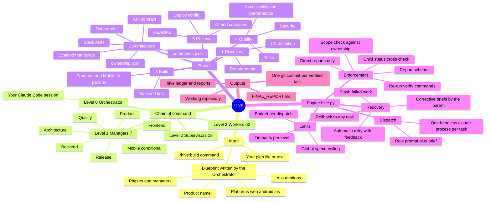

# 01. Mind Map: the whole system at a glance

## Reading the map

| Branch | Question it answers | Detail file |
|---|---|---|
| Input | What do I give the system? | [03 Phase workflow](03-phase-workflow.md) |
| Chain of command | Who does what? | [02 Chain of command](02-chain-of-command.md) |
| Phases | In what order is the product built? | [03 Phase workflow](03-phase-workflow.md) |
| Engine | How is every task run and checked? | [04 Dispatch lifecycle](04-dispatch-lifecycle.md), [05 Verification](05-verification-pipeline.md) |
| Recovery and limits | What happens when something fails? | [07 Failure and escalation](07-failure-and-escalation.md) |
| Outputs | What do I get at the end? | [08 State and artifacts](08-state-and-artifacts.md) |
