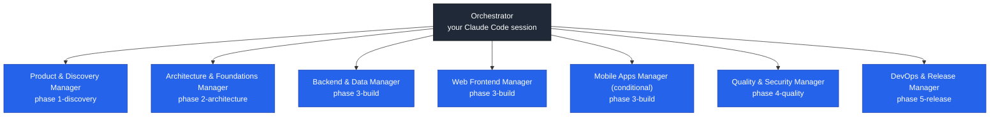
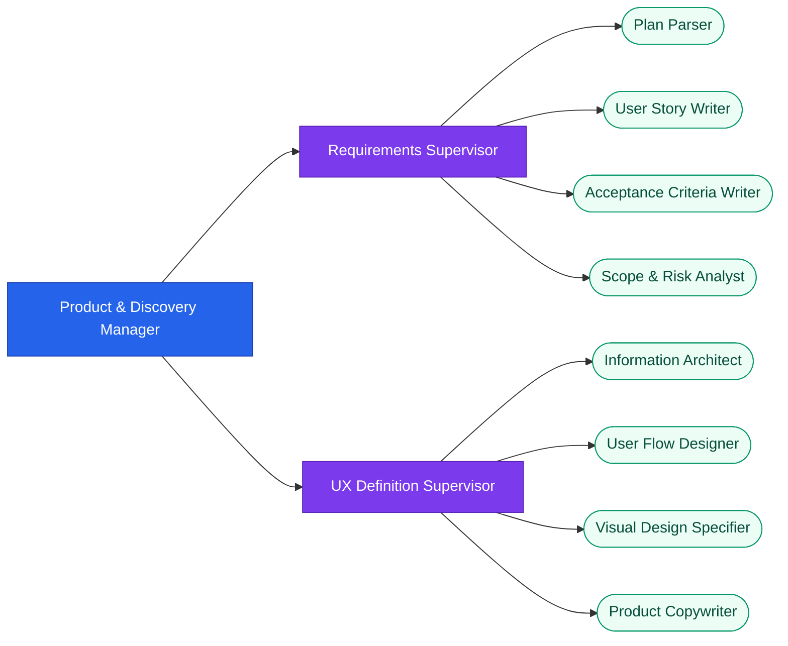
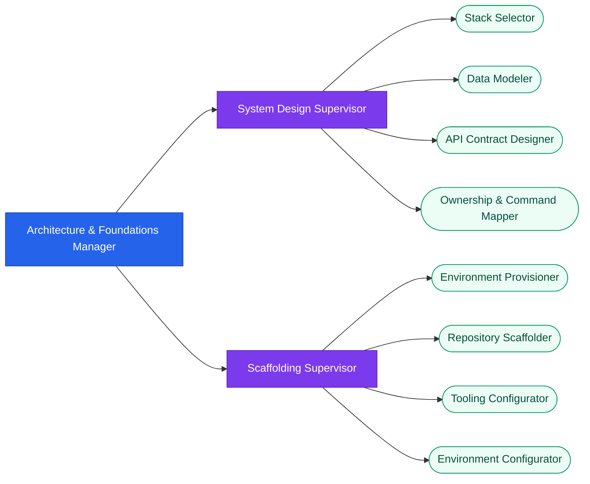
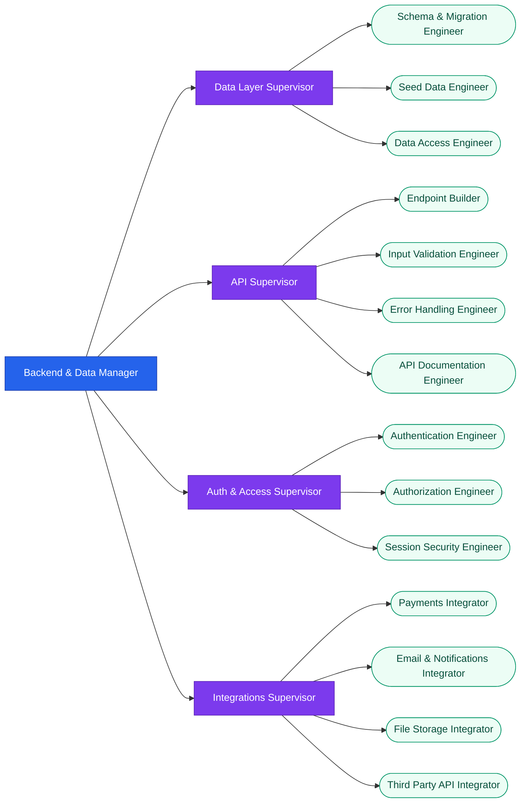
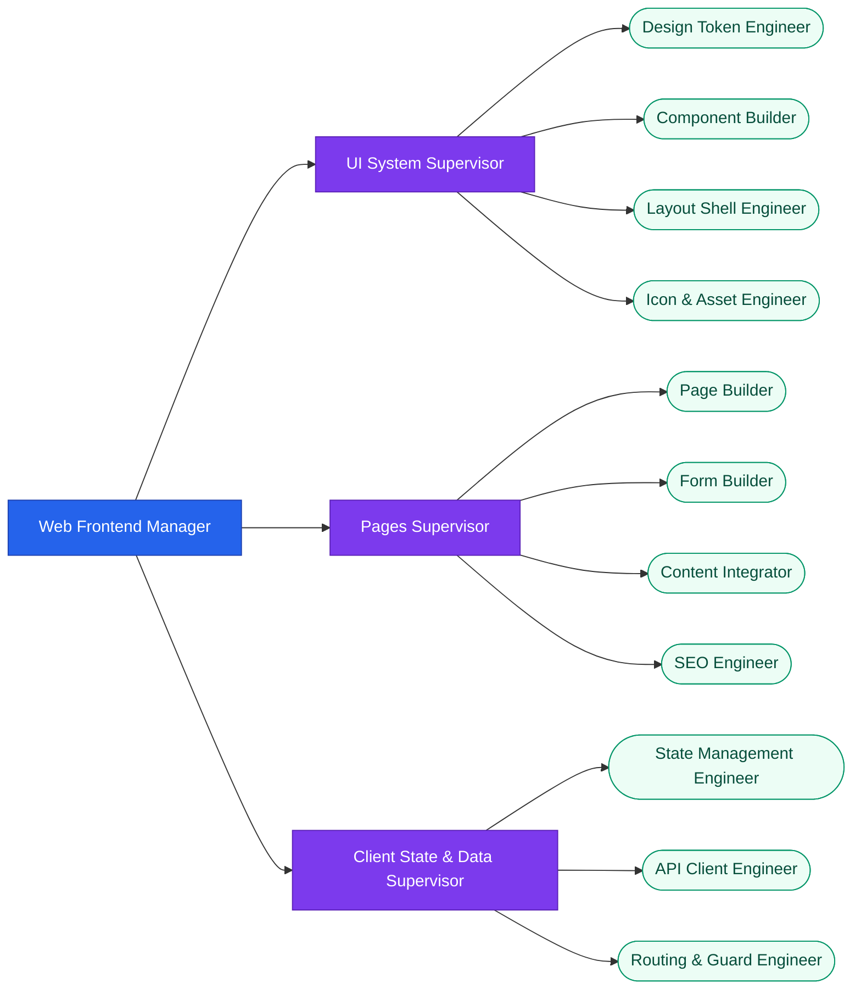
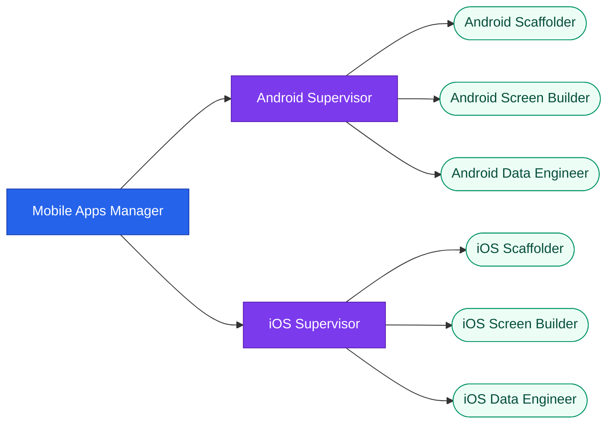
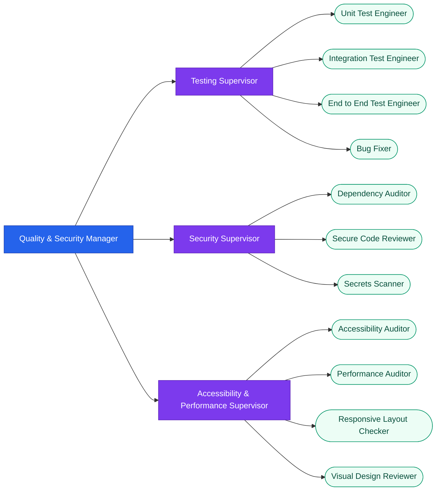
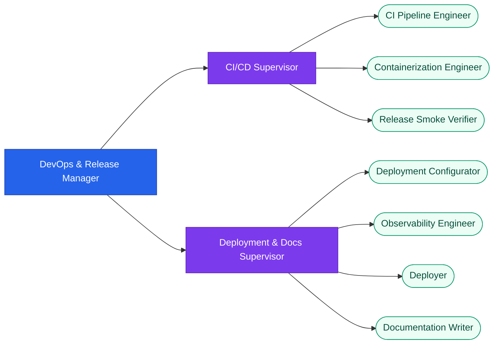

# 02. Chain of Command (all 91 roles)

Generated from `plugins/hive/skills/build/engine/roster.json`, the single source of truth. Regenerate after editing the roster with `python3 docs/system/generate_hierarchy.py`.

## Top level

## Headcount

| Level | Role | Count |
|---|---|---|
| 0 | Orchestrator | 1 |
| 1 | Manager | 7 |
| 2 | Supervisor | 18 |
| 3 | Worker | 65 |
| | **Total** | **91** |

## Product & Discovery Manager (`mgr-product`)

Turn the raw plan into an unambiguous, testable product specification and UX definition that every downstream team can build against without guessing.

| Supervisor | Worker | Task |
|---|---|---|
| `sup-requirements` | `wrk-plan-parser` | Extract every feature, constraint, persona, platform and non functional requirement from .hive/plan.md into a numbered requirements list with IDs (REQ-001...). |
| `sup-requirements` | `wrk-user-stories` | Write user stories (US-001...) in the form As a, I want, so that, each linked to its REQ IDs and prioritized MoSCoW. |
| `sup-requirements` | `wrk-acceptance-criteria` | Write Given When Then acceptance criteria (AC-001...) for every user story, each one objectively testable. |
| `sup-requirements` | `wrk-scope-risk` | Record scope boundaries, assumptions taken for ambiguous points, dependencies and a risk register with mitigations. |
| `sup-ux` | `wrk-sitemap-ia` | Define the sitemap and screen inventory per platform: every page or screen, its route, purpose, sections, data needed and access level. |
| `sup-ux` | `wrk-user-flows` | Document step by step flows for every primary task including error, empty and loading states, as Mermaid diagrams plus text. |
| `sup-ux` | `wrk-design-spec` | Specify the visual system: palette with contrast ratios, typography scale, spacing, radii, elevation, breakpoints and component patterns. |
| `sup-ux` | `wrk-copywriter` | Write final copy for every page: headings, body, CTAs, form labels, validation and error messages, empty states and emails. |

## Architecture & Foundations Manager (`mgr-architecture`)

Choose the stack, define the data model and API contract, scaffold a repository that installs, builds and tests green, and publish the ownership map and command map every later dispatch depends on.

| Supervisor | Worker | Task |
|---|---|---|
| `sup-system-design` | `wrk-stack-selector` | Select languages, frameworks, database, hosting and mobile approach that fit the plan and record the decision with alternatives and tradeoffs. Prefer mainstream, well supported, current stable versions. |
| `sup-system-design` | `wrk-data-modeler` | Design entities, fields, types, relations, indexes and constraints that serve every user story. Include an ER diagram in Mermaid. |
| `sup-system-design` | `wrk-api-contract` | Specify every endpoint: method, path, auth, request and response schemas, status codes and error format. Write OpenAPI 3.1 YAML plus a readable summary. |
| `sup-system-design` | `wrk-ownership-mapper` | Write ownership.json mapping every code owning Hive role ID to the path globs it may change (plus _shared and _ignore lists), commands.json with install, build, lint, typecheck, test, e2e and per platform commands for the chosen stack, and toolchain.json listing every required tool as {bin, version_cmd, min, install_hint, optional}. |
| `sup-scaffold` | `wrk-env-provisioner` | Make every tool in docs/architecture/toolchain.json available: detect what is installed, install missing tools non interactively with user level installers where possible (for example nvm, corepack, pipx, sdkman, the Android command line tools), and verify with `hive doctor --project`. Never use sudo unless it works without a password. Report BLOCKED with the exact install command when a tool needs elevated rights or a different operating system. |
| `sup-scaffold` | `wrk-repo-scaffolder` | Generate the project skeleton exactly per stack.md and the ownership map directory layout, using official generators non interactively where they exist. |
| `sup-scaffold` | `wrk-tooling-config` | Configure linting, formatting, type checking and the test runner, each with a script matching commands.json, plus one passing sample test. |
| `sup-scaffold` | `wrk-env-config` | Implement typed configuration loading with validation, .env.example listing every variable with comments, and safe defaults for local development. |

## Backend & Data Manager (`mgr-backend`)

Deliver the server side: persistence, API, authentication and third party integrations, exactly matching the API contract, with tests.

| Supervisor | Worker | Task |
|---|---|---|
| `sup-data` | `wrk-schema-migrator` | Implement the schema and migrations from data-model.md, with indexes and constraints, applying cleanly from an empty database. |
| `sup-data` | `wrk-seed-data` | Create idempotent seed scripts with realistic development data covering every entity and edge case needed by the UI. |
| `sup-data` | `wrk-repository-layer` | Implement the repository or data access layer for every entity with unit tests against a test database or in memory equivalent. |
| `sup-api` | `wrk-endpoint-builder` | Implement the assigned endpoints exactly per api-contract.md with tests for success and failure paths. |
| `sup-api` | `wrk-validation` | Add schema based input validation to every endpoint with precise error messages and tests for invalid input. |
| `sup-api` | `wrk-error-handling` | Implement a consistent error model, central error handler, structured logging of failures and 404 and 500 handling, with tests. |
| `sup-api` | `wrk-api-docs` | Serve or generate API reference docs from the implemented API and verify they match openapi.yaml. |
| `sup-auth` | `wrk-auth-flow` | Implement the required authentication flows with salted hashing or a vetted provider, email verification and reset where required, with tests. |
| `sup-auth` | `wrk-rbac` | Implement roles, permissions and ownership checks on every protected resource, with tests that prove denial. |
| `sup-auth` | `wrk-session-security` | Harden sessions or tokens: secure cookies, expiry, rotation, CSRF protection, rate limiting on auth endpoints and security headers. |
| `sup-integrations` | `wrk-payments` | Integrate the payment provider behind an adapter with webhook signature verification and idempotency, tested with a fake. |
| `sup-integrations` | `wrk-email-notify` | Implement transactional email and notifications behind an adapter with templates from copy.md and a console transport for development. |
| `sup-integrations` | `wrk-file-storage` | Implement file upload and storage behind an adapter with type and size validation and a local disk driver for development. |
| `sup-integrations` | `wrk-third-party` | Integrate any other external API the plan requires behind an adapter with timeouts, retries and a fake for tests. |

## Web Frontend Manager (`mgr-frontend`)

Deliver the complete web user interface: design system, every page in the sitemap, client state and API wiring, responsive and accessible.

| Supervisor | Worker | Task |
|---|---|---|
| `sup-ui-system` | `wrk-design-tokens` | Implement design-spec.md as code level tokens (CSS variables or theme config) including light and dark modes if specified. |
| `sup-ui-system` | `wrk-component-builder` | Build the assigned reusable components with all variants and states, keyboard support and ARIA, plus tests. |
| `sup-ui-system` | `wrk-layout-shell` | Build the app shell: header, navigation, footer, responsive layout grid and error boundary. |
| `sup-ui-system` | `wrk-assets` | Set up the icon system, favicon set, logo placeholder and optimized image handling. |
| `sup-pages` | `wrk-page-builder` | Build the assigned pages from sitemap.md using the component library, with loading, empty and error states. |
| `sup-pages` | `wrk-form-builder` | Build the assigned forms with client validation matching server validation, accessible errors and submit states. |
| `sup-pages` | `wrk-content-integrator` | Place final copy from copy.md into every page and remove all placeholder text. |
| `sup-pages` | `wrk-seo-meta` | Add titles, descriptions, Open Graph tags, canonical URLs, sitemap.xml, robots.txt and structured data where relevant. |
| `sup-client-state` | `wrk-state-manager` | Implement client and server state management with caching and invalidation per the chosen stack. |
| `sup-client-state` | `wrk-api-client` | Implement a typed API client that matches openapi.yaml, handles auth and errors uniformly, and is shared with mobile when the stack allows. |
| `sup-client-state` | `wrk-routing-guard` | Implement routing, route guards for authenticated and role restricted pages, and redirects, with tests. |

## Mobile Apps Manager (`mgr-mobile`)

Deliver the requested native or cross platform mobile apps that consume the same API contract as the web app. Prefer a cross platform stack (Expo / React Native) unless the plan demands native, because it can be verified on any host and shares the web API client.

| Supervisor | Worker | Task |
|---|---|---|
| `sup-android` | `wrk-android-scaffold` | Scaffold the Android project per stack.md with build configuration, theming from design-spec.md and navigation. |
| `sup-android` | `wrk-android-screens` | Build the assigned Android screens with all states, following platform conventions. |
| `sup-android` | `wrk-android-data` | Implement the Android networking, persistence and auth token storage wired to the API contract. |
| `sup-ios` | `wrk-ios-scaffold` | Scaffold the iOS project per stack.md with build configuration, theming from design-spec.md and navigation. |
| `sup-ios` | `wrk-ios-screens` | Build the assigned iOS screens with all states, following Human Interface Guidelines. |
| `sup-ios` | `wrk-ios-data` | Implement the iOS networking, persistence and Keychain token storage wired to the API contract. |

## Quality & Security Manager (`mgr-quality`)

Prove the product works and is safe: test coverage across levels, security review, accessibility, performance and responsiveness, and fix what fails.

| Supervisor | Worker | Task |
|---|---|---|
| `sup-testing` | `wrk-unit-tester` | Write unit tests for untested logic in the assigned area, targeting behavior from acceptance-criteria.md. |
| `sup-testing` | `wrk-integration-tester` | Write integration tests across API, database and auth for the assigned flows. |
| `sup-testing` | `wrk-e2e-tester` | Write end to end browser tests (Playwright) for the assigned user flows against a locally started app. |
| `sup-testing` | `wrk-bug-fixer` | Reproduce the assigned failing test or defect, find the root cause, fix it at the source and prove the fix with a test. Never weaken or skip a test to make it pass. |
| `sup-security` | `wrk-dependency-auditor` | Run the ecosystem audit tool, upgrade or replace vulnerable dependencies, and record residual findings. |
| `sup-security` | `wrk-secure-code-reviewer` | Review the code for OWASP Top 10 issues (injection, broken access control, XSS, SSRF, insecure deserialization, misconfiguration) and fix confirmed findings with tests. |
| `sup-security` | `wrk-secrets-scanner` | Scan the repository and git history for committed secrets and unsafe config, move values to environment variables and update .env.example. |
| `sup-experience-audit` | `wrk-a11y-auditor` | Audit core flows against WCAG 2.1 AA (automated axe checks plus manual keyboard and semantics review) and fix violations. |
| `sup-experience-audit` | `wrk-performance-auditor` | Measure bundle size and page performance, remove waste, add lazy loading and caching, and report before and after numbers. |
| `sup-experience-audit` | `wrk-responsive-checker` | Render every page at 360px, 768px and 1280px with Playwright screenshots, fix overflow and layout breakage. |
| `sup-experience-audit` | `wrk-visual-reviewer` | Start the app, capture Playwright screenshots of every sitemap page at 360px, 768px and 1280px into docs/quality/screenshots/, open each image with the Read tool and judge it against docs/product/design-spec.md: hierarchy, spacing, alignment, contrast, typography, consistency, polish. Fix visual defects in code, re-capture, and write docs/quality/visual-review.md with before and after notes per page. |

## DevOps & Release Manager (`mgr-release`)

Make the product shippable: CI pipeline, containerization, deployment configuration, observability, and documentation a new engineer can follow.

| Supervisor | Worker | Task |
|---|---|---|
| `sup-cicd` | `wrk-ci-pipeline` | Write the CI workflow (GitHub Actions by default) that installs, lints, typechecks, tests and builds with caching. |
| `sup-cicd` | `wrk-containerizer` | Write a multi stage Dockerfile, .dockerignore and docker compose for local services, running as a non root user. |
| `sup-cicd` | `wrk-release-verifier` | Build the production artifact, start it, and run a scripted smoke test against health and key pages. Report exact results. |
| `sup-deploy-docs` | `wrk-deploy-config` | Write deployment configuration for the hosting target in stack.md and a step by step deploy guide in docs/release/deploy.md. |
| `sup-deploy-docs` | `wrk-observability` | Add a health endpoint, structured logging, error reporting hooks and basic request metrics. |
| `sup-deploy-docs` | `wrk-deployer` | Deploy the product to the hosting target in stack.md when its credentials are present in the environment (for example VERCEL_TOKEN, NETLIFY_AUTH_TOKEN, FLY_API_TOKEN, RENDER_API_KEY, EXPO_TOKEN for mobile builds), then verify the live URL with an HTTP check of the health endpoint and key pages. When credentials are absent, do not fake it: report the exact variables needed and the one command that will deploy once they are set. |
| `sup-deploy-docs` | `wrk-docs-writer` | Write README.md (overview, prerequisites, setup, run, test, deploy, structure) and verify each command by running it. |
