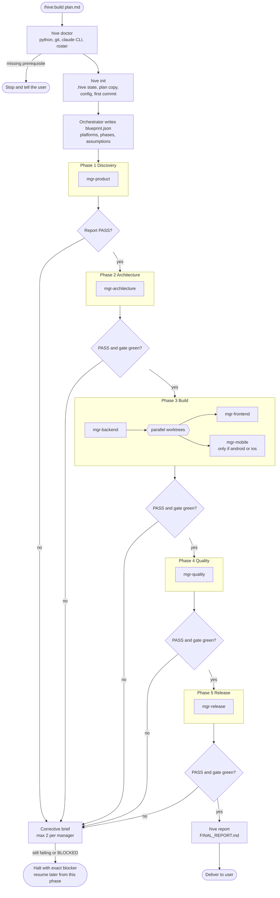
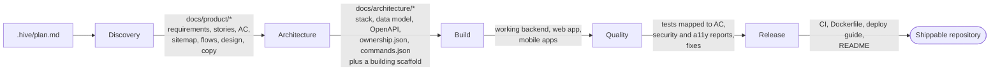
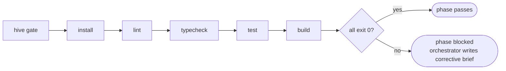

# 03. Phase Workflow: from plan to shippable product

The Orchestrator runs five phases in a fixed order. No phase starts until the previous one has a PASS report and a green gate.

## End to end flow

## Phase timeline

```mermaid
gantt
    title Typical build sequence (relative, not real durations)
    dateFormat X
    axisFormat %s
    section Orchestrator
    Preflight and blueprint     :o1, 0, 1
    section Phase 1
    mgr-product                 :p1, 1, 4
    section Phase 2
    mgr-architecture            :p2, 4, 8
    Gate 2                      :milestone, 8, 0
    section Phase 3
    mgr-backend                 :p3a, 8, 14
    mgr-frontend                :p3b, 14, 21
    mgr-mobile                  :p3c, 14, 21
    Gate 3                      :milestone, 21, 0
    section Phase 4
    mgr-quality                 :p4, 21, 26
    section Phase 5
    mgr-release                 :p5, 26, 29
    Final report                :milestone, 29, 0
```

## What each phase hands to the next

## Gate contents

A gate is `hive gate --phase <id>`. It runs these keys from `docs/architecture/commands.json` and records the result in `.hive/gates.json`.

Phase 1 has no gate because no code exists yet. Phase 2 is the first gated phase: the empty scaffold must already install, lint, test and build.
