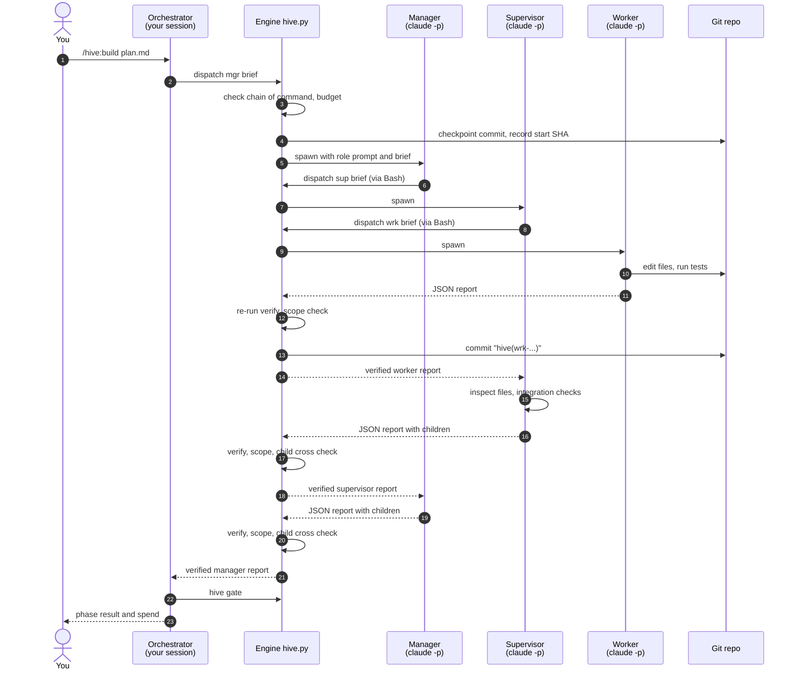
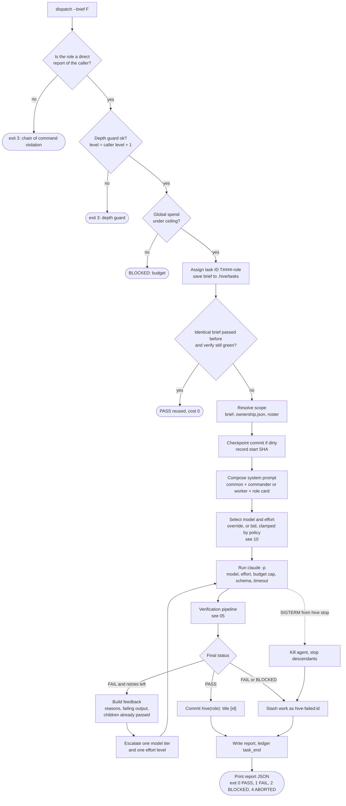
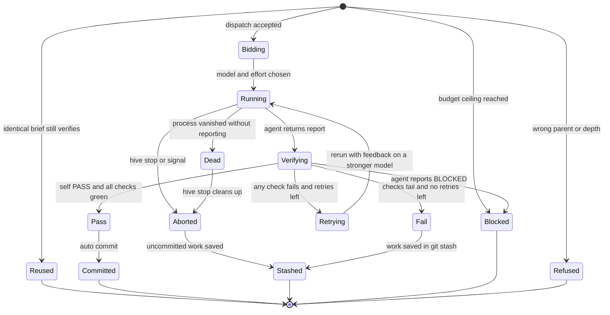
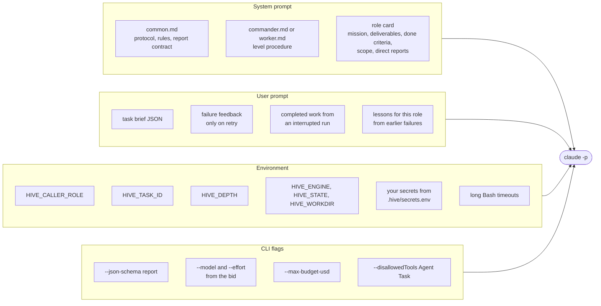

# 04. Dispatch Lifecycle: how one level calls the next

Every delegation, at every level, goes through the same command: `python3 hive.py dispatch --brief <file>`. The engine sits between parent and child.

## Four level call chain

## Inside a single dispatch

## Task states

## What a child process receives

`HIVE_CALLER_ROLE` is how the engine knows who is calling when the child itself dispatches. Native subagents are disabled, so the only way down the chain is through the engine.
