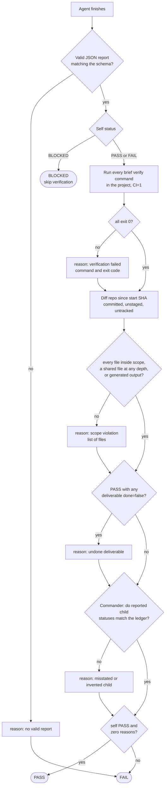
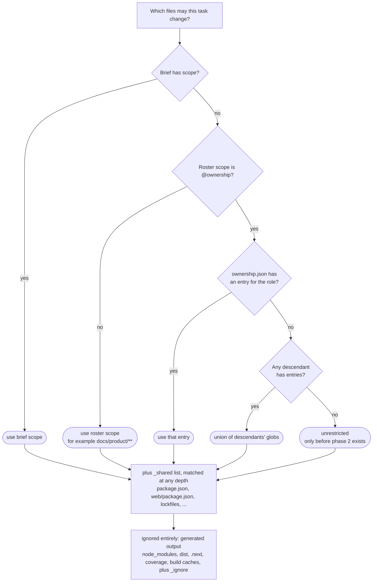
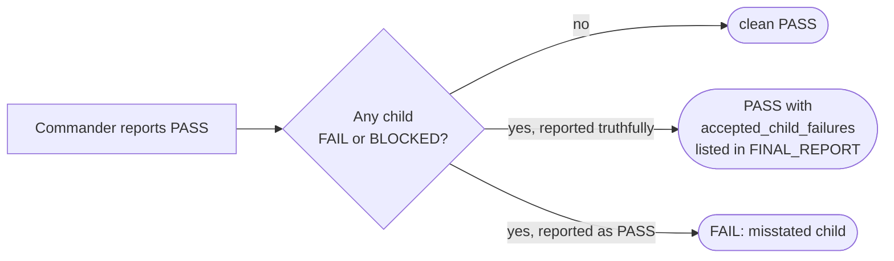

# 05. Verification Pipeline: how a report becomes PASS

An agent's own PASS is only a claim. The engine turns it into a verdict by running these checks after every attempt.

## The five checks

| # | Check | Catches | Source of truth |
|---|---|---|---|
| 1 | Schema | Rambling or missing reports | `--json-schema` plus engine parsing |
| 2 | Verify commands | "Tests pass" claims that are false | Commands in the brief, run by the engine |
| 3 | Scope | Agents editing other teams' files | `ownership.json` or brief scope, shared and ignore lists |
| 4 | Deliverables | PASS with admitted gaps | The agent's own deliverables list |
| 5 | Child cross check | Commanders hiding child failures | `.hive/ledger.jsonl` |

## Scope resolution

## Commander accountability

A manager or supervisor may still PASS when a child failed, for example after a corrective dispatch succeeded or after it audited the result itself. It cannot hide that decision.

