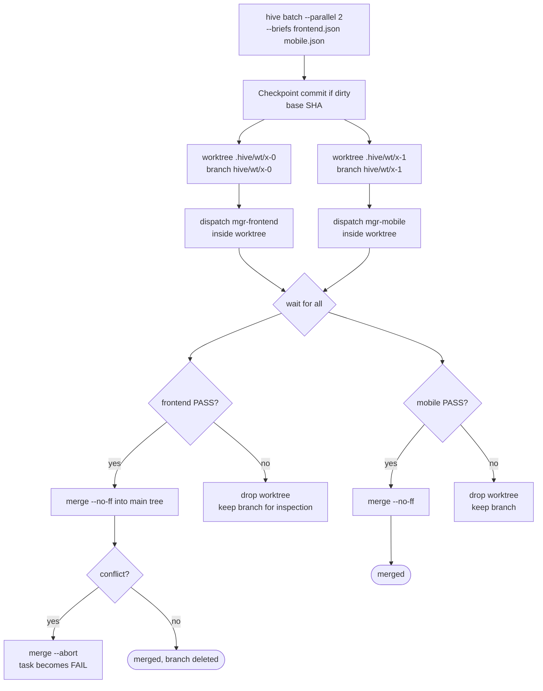
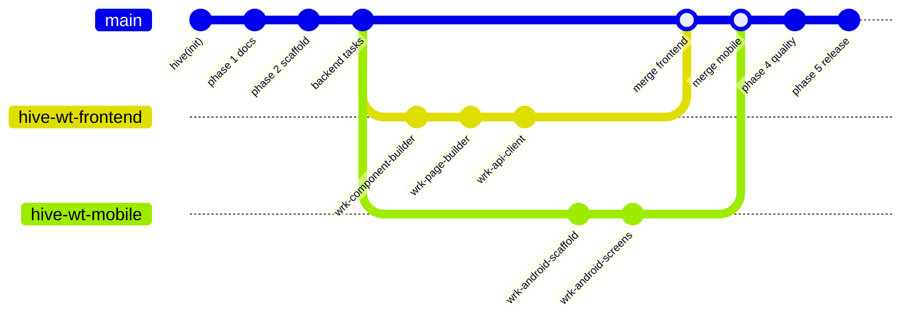
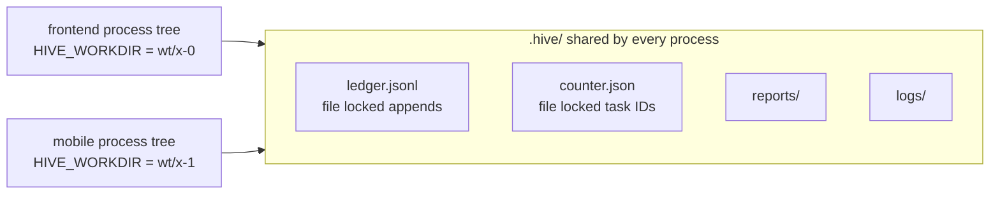

# 06. Parallel Execution: isolated git worktrees

Independent tasks with disjoint scopes run at the same time through `hive batch --parallel N`. Each one works in its own git worktree, so agents never write over each other.

## Batch flow

## Git history shape

## Shared state across processes

All parallel processes share one `.hive/` directory through `HIVE_STATE`, while `HIVE_WORKDIR` points each one at its own worktree.

The safety condition is disjoint scopes. The architecture phase's `ownership.json` is designed to make the frontend and mobile areas disjoint. If two parallel tasks still touch the same file, the merge conflict is caught and that task is failed rather than silently overwritten.
