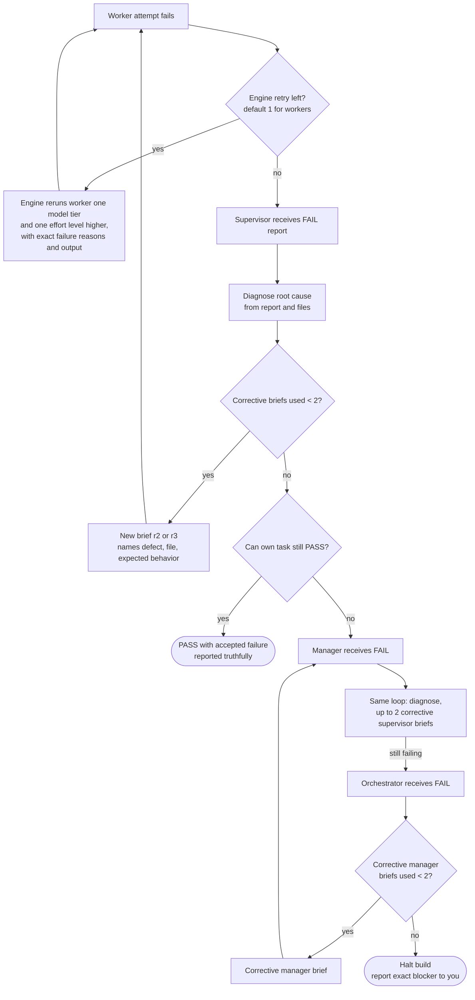
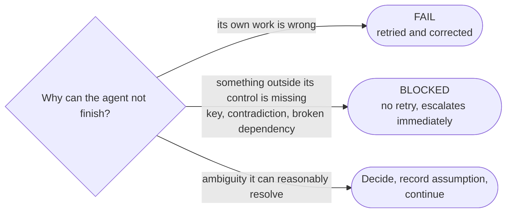
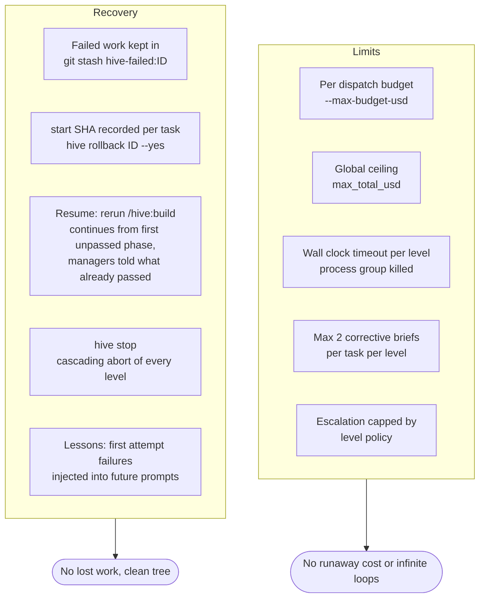
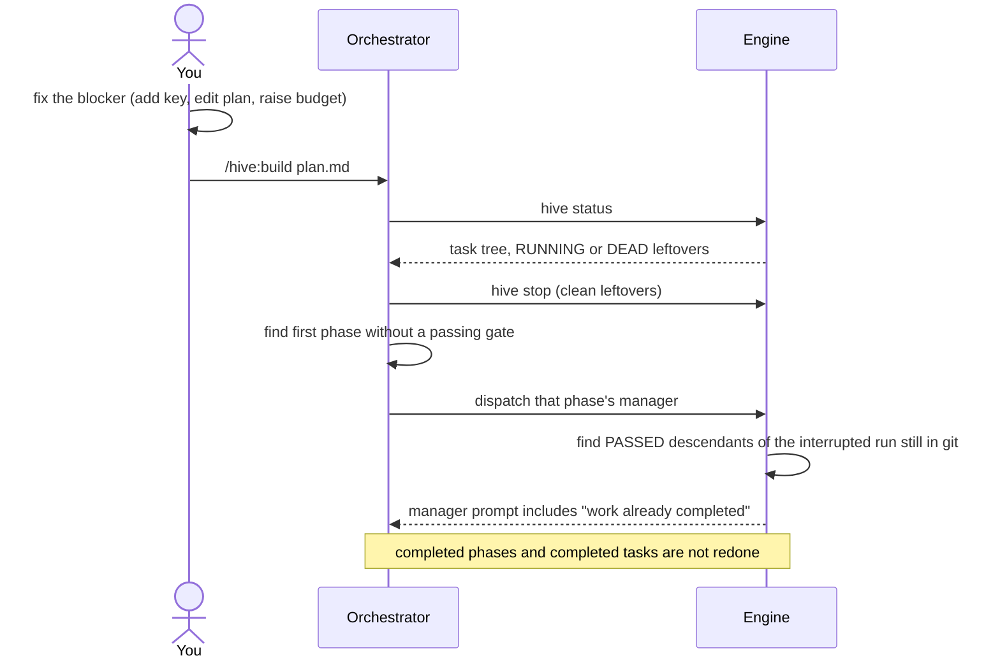

# 07. Failure Handling and Escalation

Failures are handled at the lowest level that can fix them, then escalate one level at a time.

## Escalation ladder

## Who fixes what

| Failure type | Fixed by | How |
|---|---|---|
| Typo, failing test the worker caused | Worker on automatic retry | Feedback includes the failing output |
| Wrong or unclear brief | Supervisor | Corrective brief with specific instructions |
| Integration break between workers | Supervisor glue fix or new worker task | Supervisor runs integration checks |
| Area wide design problem | Manager | Re-plans supervisor briefs |
| Missing credential, contradictory plan | You | Agent reports BLOCKED with the exact need |
| Spend ceiling reached | You | Raise `max_total_usd` and resume |

## Blocked vs failed

## Safety nets

## Resume after a halt

