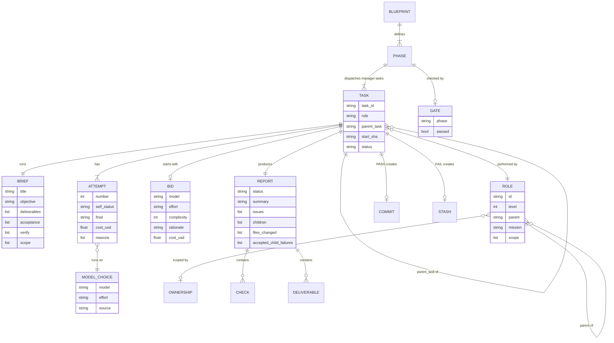
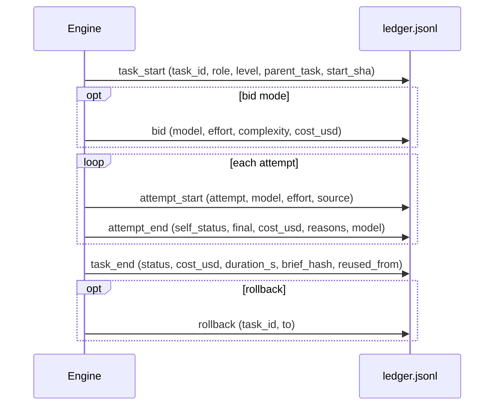
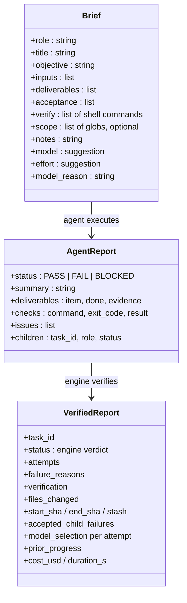

# 08. State and Artifacts: where everything is stored

## Repository layout during a build

```mermaid
flowchart TD
    Root["your project/"] --> H[".hive/ (git ignored)"]
    Root --> DP["docs/product/<br/>phase 1 output"]
    Root --> DA["docs/architecture/<br/>phase 2 output"]
    Root --> DQ["docs/quality/<br/>phase 4 output"]
    Root --> DR["docs/release/<br/>phase 5 output"]
    Root --> Src["application code<br/>layout from ownership.json"]
    H --> H1["plan.md"]
    H --> H2["blueprint.json"]
    H --> H3["config.json"]
    H --> H4["ledger.jsonl"]
    H --> H5["tasks/ID.json briefs as dispatched"]
    H --> H6["briefs/ID/ briefs a commander wrote"]
    H --> H7["reports/ID.json verified reports"]
    H --> H8["logs/ID.jsonl full agent transcripts"]
    H --> H9["gates.json"]
    H --> H10["wt/ temporary worktrees"]
    H --> H11["FINAL_REPORT.md"]
    H --> H12["secrets.env<br/>your keys, passed as env, redacted in logs"]
    H --> H13["lessons.json<br/>also ~/.hive/lessons.json"]
    H --> H14["run/ID.json<br/>live process IDs for stop"]
    H --> H15["RETRO.md"]
    DA --> O1["ownership.json<br/>who may change which paths"]
    DA --> O2["commands.json<br/>install, lint, test, build"]
    DA --> O3["toolchain.json<br/>required tools and versions"]
    Root --> GH["~/.hive/config.json<br/>your global defaults"]
```

## Data model

## Ledger events

Every process appends to one locked file. `hive status` and `hive report` are computed from it.

## Brief and report contract

