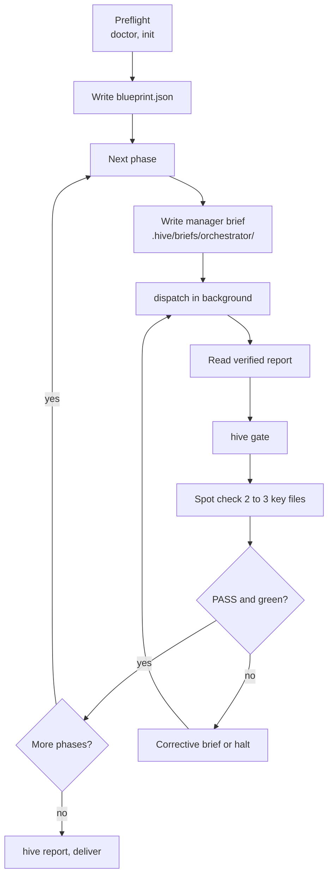
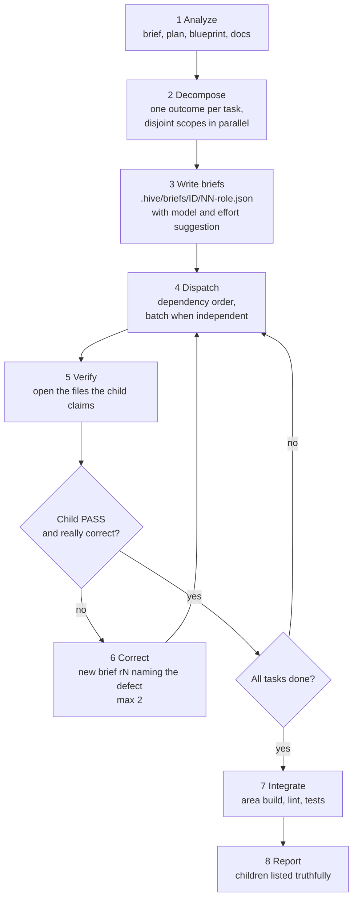
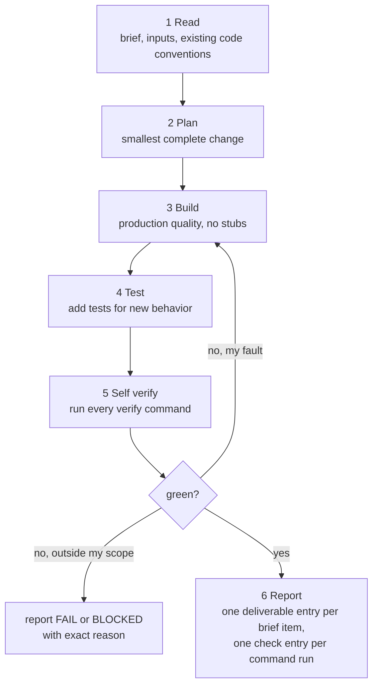
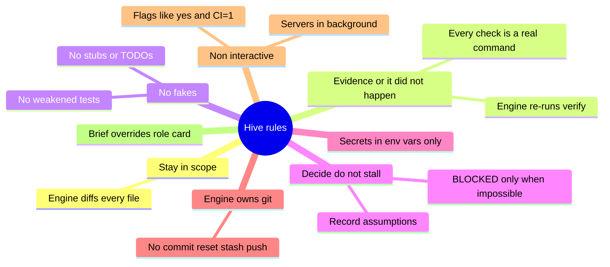
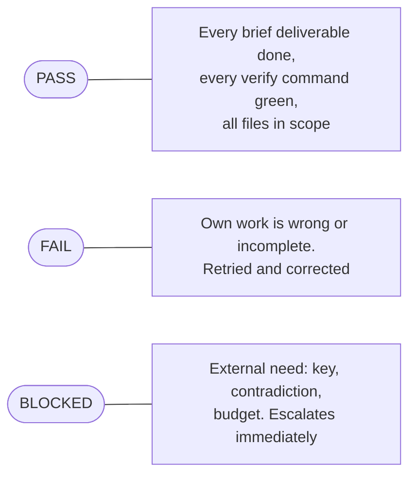

# 09. Agent Protocols: how each level thinks

Each level follows a fixed procedure defined in `plugins/hive/skills/build/engine/prompts/` and, for the Orchestrator, in `skills/build/SKILL.md`.

## Orchestrator (level 0)

## Commander: Manager (level 1) and Supervisor (level 2)

| | Manager | Supervisor |
|---|---|---|
| Writes product code | Never | Small glue fixes in scope only |
| Dispatches | Its supervisors | Its workers |
| Model | bids per task, allowed sonnet or opus | bids per task, allowed haiku, sonnet or opus |
| Default retries by engine | 0 | 1 |
| On retry | never redispatches children that passed | never redispatches children that passed |

## Worker (level 3)

## Rules every agent follows

## Report vocabulary

