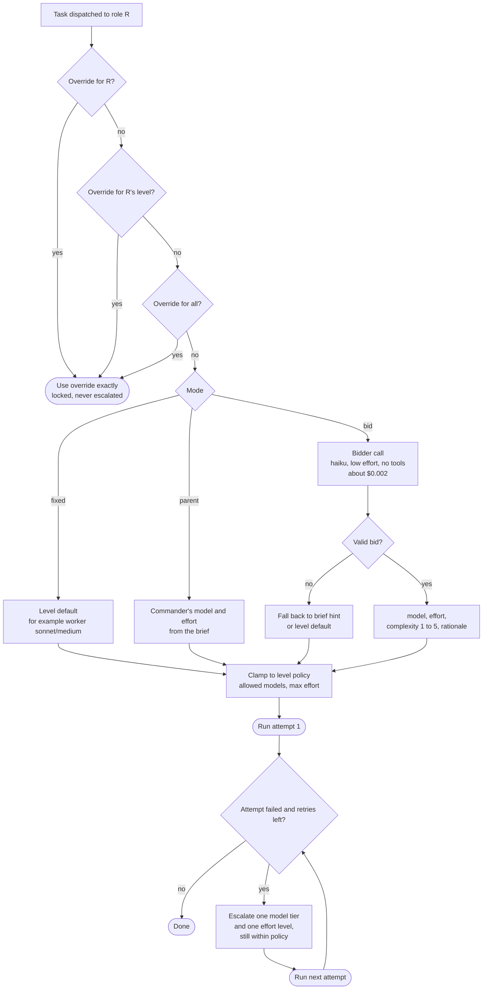
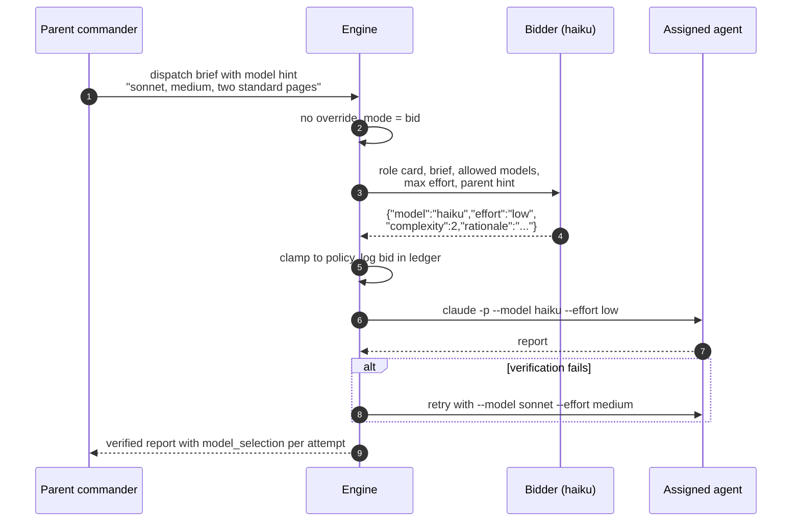
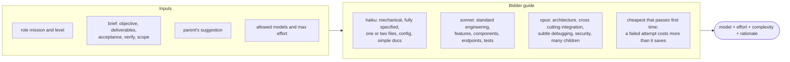
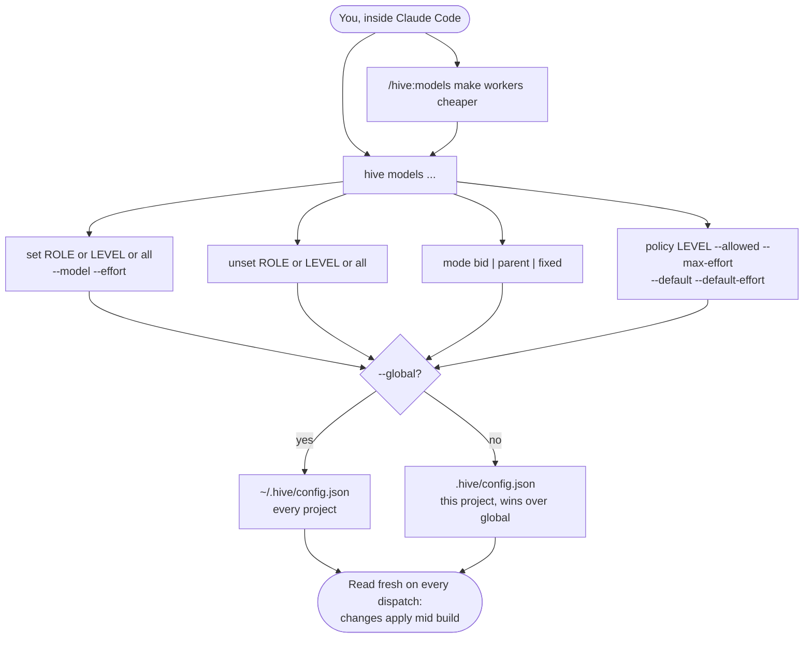
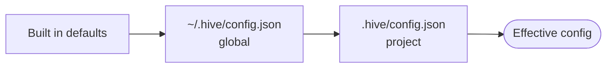
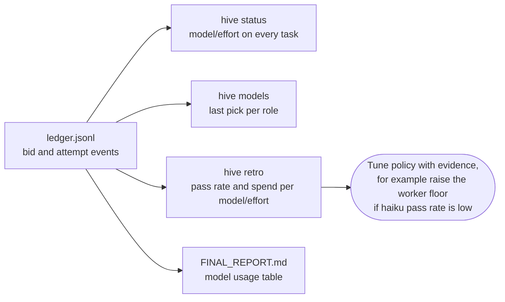

# 10. Model Bidding: every agent picks its own model and effort

Before a task runs, the agent assigned to it bids for the model and effort it needs. Your policy bounds the bid, your overrides beat it, and a failed attempt automatically moves up a tier.

## Decision flow for one task

## The bid

## How a bid is judged

## Default policy

| Level | Allowed models | Max effort | Default (fixed mode, fallback) | Engine retries |
|---|---|---|---|---|
| Manager | sonnet, opus | xhigh | opus / high | 0 |
| Supervisor | haiku, sonnet, opus | high | sonnet / medium | 1 |
| Worker | haiku, sonnet, opus | high | sonnet / medium | 1 |

Escalation ladder: `haiku → sonnet → opus` and `low → medium → high → xhigh → max`, each capped by the level's policy.

## Your controls

## Configuration layers

## Seeing what was chosen

