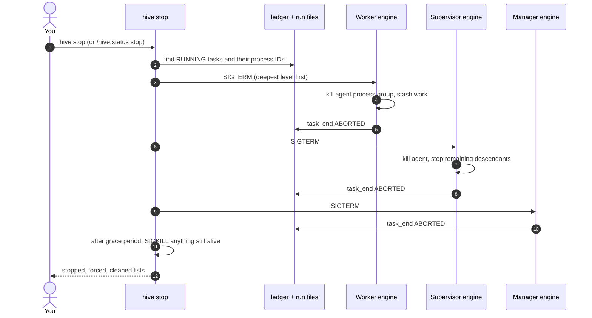
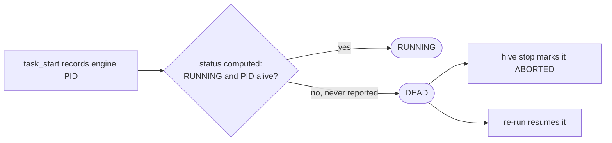
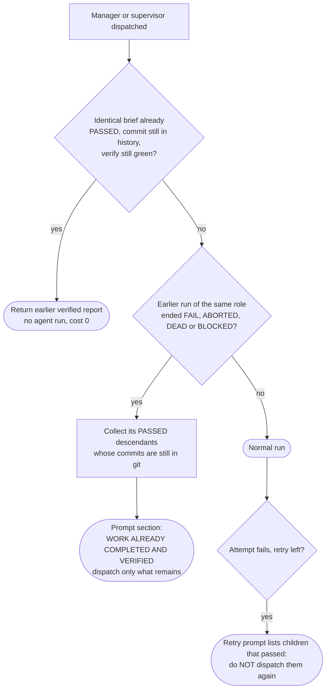
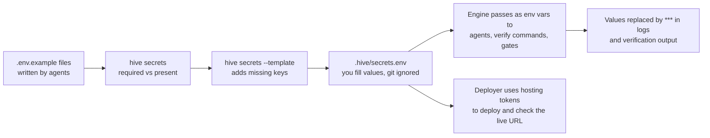
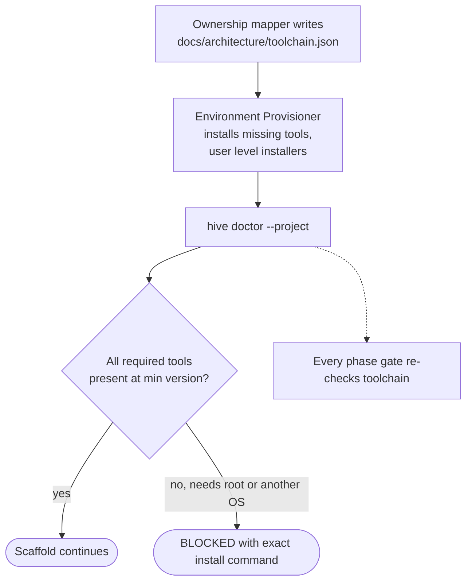
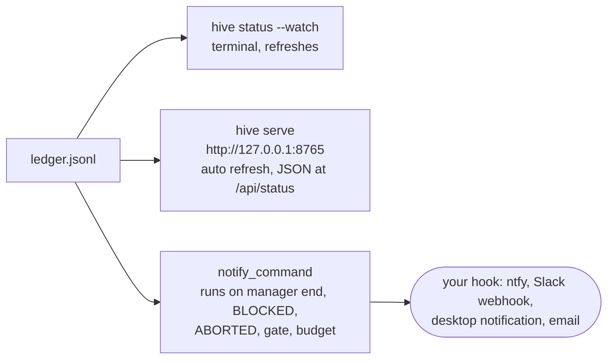
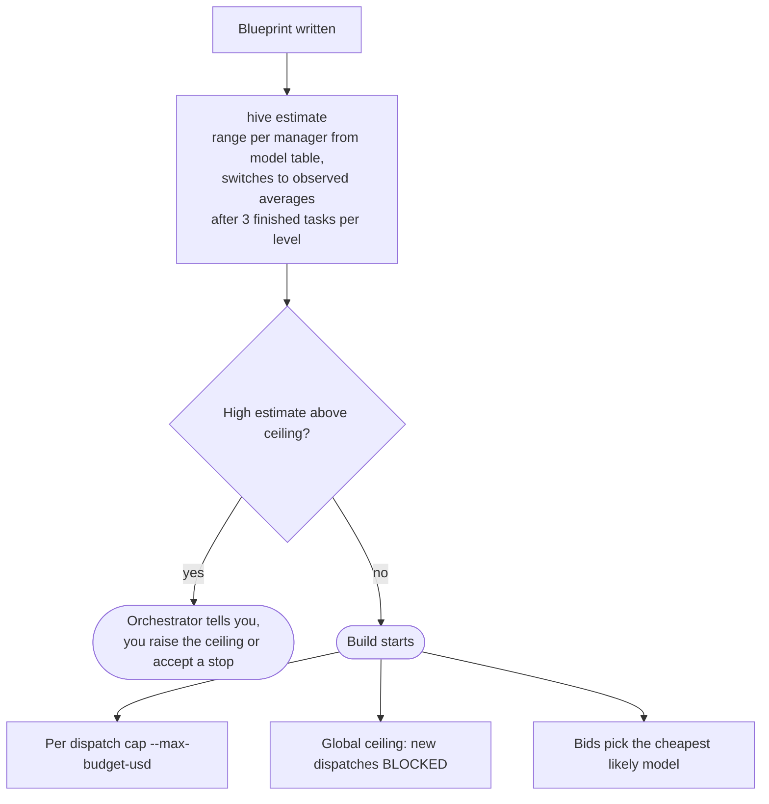
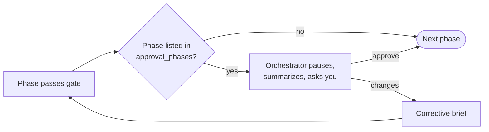
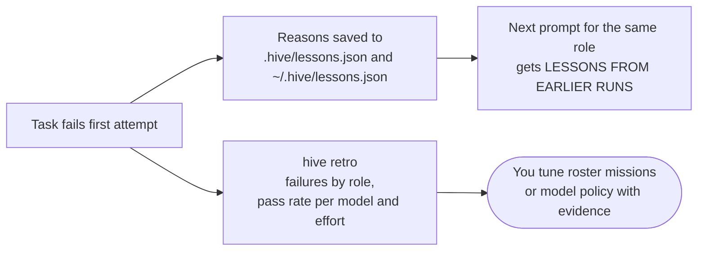

# 11. Operations and Control: stop, resume, reuse, secrets, watch, learn

## Stopping a build

## Liveness

## Resume and reuse

## Secrets

## Environment provisioning

## Watching

## Cost control before and during the build

## Human review points

Enable with `/hive:build plan.md --review` (Discovery and Architecture) or `hive config set approval_phases '["1-discovery","2-architecture"]'`.

## Learning between runs

