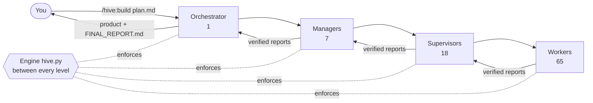

# Hive System Diagrams

Visual documentation of how the Hive works, from the plan you give it to the shippable repository it hands back. Every diagram is Mermaid, so GitHub renders it directly.

## Start here



## Contents

| File | Diagram types | Explains |
|---|---|---|
| [01 Mind map](01-mind-map.md) | mind map | The whole system on one page |
| [02 Chain of command](02-chain-of-command.md) | org charts, tables | All 91 roles, who reports to whom, what each worker does |
| [03 Phase workflow](03-phase-workflow.md) | flowchart, gantt | The 5 phases, gates, and what each phase hands over |
| [04 Dispatch lifecycle](04-dispatch-lifecycle.md) | sequence, flowchart, state | How one level calls the next, inside a single dispatch |
| [05 Verification pipeline](05-verification-pipeline.md) | flowcharts | How an agent's claim becomes a PASS or FAIL verdict |
| [06 Parallel execution](06-parallel-execution.md) | flowchart, git graph | Isolated worktrees and merging |
| [07 Failure and escalation](07-failure-and-escalation.md) | flowcharts, sequence | Retries, corrective briefs, halts and resume |
| [08 State and artifacts](08-state-and-artifacts.md) | tree, ER, class, sequence | Every file the Hive writes and its data model |
| [09 Agent protocols](09-agent-protocols.md) | flowcharts, mind map | The procedure each level follows |
| [10 Model bidding](10-model-bidding.md) | sequence, flowcharts, state | How each agent picks its model and effort, and how you control it |
| [11 Operations and control](11-operations-and-control.md) | flowcharts, sequence | Stop, resume, reuse, secrets, dashboard, notifications, lessons |

## Keeping diagrams accurate

`02-chain-of-command.md` is generated from `plugins/hive/skills/build/engine/roster.json`. After changing the roster run:

```bash
python3 docs/system/generate_hierarchy.py
```

The other files describe behavior implemented in `engine/hive.py`, `engine/prompts/` and `skills/build/SKILL.md`. Update them in the same commit as any change to those files.
